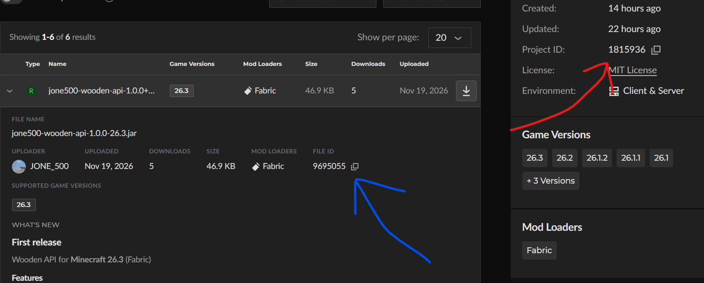

# Wooden API

A Fabric library for **Minecraft 1.21.9 to 26.3** that lets you add these things for your own
wood type with a few lines of code:

- Sign (standing + on a wall)
- Hanging sign (under a block + on a wall)
- Boat + boat with chest (or a bamboo-style raft + raft with chest)
- Shelf

Wooden API also generates the blockstates, models, recipes, loot tables, tags and English names
for you.

**Not included:** logs, planks, stairs, slabs, doors, fences and other wood blocks. Make those
yourself as usual. Wooden API only adds the things above, which are the hard ones.

## Supported Minecraft versions

Each Minecraft version has its own Wooden API file. On the
[Modrinth versions page](https://modrinth.com/mod/jone500-wooden-api/versions), pick the file for
**your** Minecraft version and use its version number in [step 1](#1-add-wooden-api-to-your-mod).

The version number has two parts: the Wooden API version, then `+`, then the Minecraft version.

```
1.0.0+1.21.10
└─┬─┘ └──┬──┘
  │      └── for Minecraft 1.21.10
  └───────── Wooden API version 1.0.0
```

So for Minecraft 1.21.9 you would use `1.0.0+1.21.9`, and for 1.21.10 `1.0.0+1.21.10`. The
examples below use `1.0.0+1.21.10`; change the part after `+` to **your** Minecraft version.

## Requirements

- Fabric Loader (0.20.1 or newer for 1.21.10)
- **Fabric API**
- The Java version your Minecraft version needs (Java **21** for 1.21.x)

## Overview

1. [Add Wooden API to your mod](#1-add-wooden-api-to-your-mod)
2. [Register your wood](#2-register-your-wood) (a few lines of Java)
3. [Draw the textures](#3-draw-the-textures)
4. [Run data generation](#4-run-data-generation) (makes the JSON files for you)
5. [Test it in game](#5-test-it-in-game)

If something does not work, see [Common problems](#common-problems).

---

## 1. Add Wooden API to your mod

In your `build.gradle`, add the Modrinth repository and Wooden API:

```groovy
repositories {
    exclusiveContent {
        forRepository {
            maven {
                name = "Modrinth"
                url = "https://api.modrinth.com/maven"
            }
        }
        filter {
            includeGroup "maven.modrinth"
        }
    }
}

dependencies {
    modImplementation "maven.modrinth:jone500-wooden-api:1.0.0+1.21.10"

    // Optional, see below
    // include "maven.modrinth:jone500-wooden-api:1.0.0+1.21.10"
}
```

Then reload Gradle in your IDE (IntelliJ: the elephant "Load Gradle Changes" button).

In your `fabric.mod.json`, add Wooden API to `depends`:

```json
"depends": {
    "jone500_wooden_api": ">=1.0.0"
}
```

Here you write only the Wooden API part (`1.0.0`), without `+1.21.10`. If a player has an older
Wooden API than this, Fabric shows a clear "please update Wooden API"
message instead of crashing.

**What is `include`?**

`include` packs Wooden API **inside your mod's jar file**. When a player installs your mod, Wooden
API comes with it, so they don't have to find and download Wooden API themselves. Fabric loads it
from inside your jar automatically.

To use it, remove the `//` in front of the `include` line above. Keep the `modImplementation` line
too: you need both. Your `dependencies` in `build.gradle` then look like this:

```groovy
dependencies {
    modImplementation "maven.modrinth:jone500-wooden-api:1.0.0+1.21.10"   // lets you use Wooden API in your code
    include "maven.modrinth:jone500-wooden-api:1.0.0+1.21.10"             // puts Wooden API inside your mod's jar
}
```

Use the **same version number** on both lines.

- **With `include`:** players only download your mod (and Fabric API). Your jar gets a little
  bigger.
- **Without `include`:** players must download Wooden API separately. On Modrinth, add it as a
  *required dependency* of your mod so launchers download it automatically.

Both are fine. `include` is easier for players.

If several mods include different Wooden API versions, Fabric loads only the newest one, so they
don't conflict.

### Getting Wooden API from CurseForge instead (CurseMaven)

Wooden API is also on [CurseForge](https://www.curseforge.com/minecraft/mc-mods/jone500-wooden-api).
CurseForge has no Maven of its own, so you use **CurseMaven**, a free service that turns CurseForge
files into Gradle dependencies. Use it in place of the Modrinth repository above (you don't need
both).

**1. Find the file ID.** On CurseForge, open **Files**, click the file for **your** Minecraft
version, and copy the **File ID** number. Each Minecraft version has a different file ID.



- **Project ID** (red arrow, in the box on the **right** side of the page): `1815936`. The same for
  every file.
- **File ID** (blue arrow, in the file's details, under **FILE ID**): `9695055` in the picture (the
  26.3 file). Different for every file. The small button next to each number copies it.

**2. Add CurseMaven to `build.gradle`:**

```groovy
repositories {
    exclusiveContent {
        forRepository {
            maven {
                name = "CurseMaven"
                url = "https://cursemaven.com"
            }
        }
        filter {
            includeGroup "curse.maven"
        }
    }
}

dependencies {
    modImplementation "curse.maven:jone500-wooden-api-1815936:9695006"

    // Optional: put Wooden API inside your mod's jar (see "What is include?" above)
    // include "curse.maven:jone500-wooden-api-1815936:9695006"
}
```

The dependency has three parts:

```
curse.maven:jone500-wooden-api-1815936:9695006
            └────────┬───────┘ └──┬──┘ └──┬──┘
                     │            │       └── File ID (changes for every file / Minecraft version)
                     │            └────────── Project ID of Wooden API (always 1815936)
                     └─────────────────────── any name you like, usually the mod's slug
```

`9695006` is the file for **Minecraft 1.21.10**. For another Minecraft version, replace only the last
number with the File ID from step 1.

**3.** The `fabric.mod.json` part is the same as above (`"jone500_wooden_api": ">=1.0.0"`).

If you upload your mod to CurseForge **without** `include`, add Wooden API under *Relations* as a
**Required Dependency** when you upload the file, so the CurseForge app downloads it for players.

---

## 2. Register your wood

### The name decides everything

```java
WoodSet.builder(Identifier.of("mymod", "maple"))
```

- `"mymod"` must be **your mod id** (the `"id"` in your `fabric.mod.json`).
- `"maple"` is the name of your wood. Every block, item and texture name comes from it:
  `maple_sign`, `maple_hanging_sign`, `maple_boat`, `maple_chest_boat`, `maple_shelf`,
  and so on.

### Choose what to add

| Method | What it adds | Needs |
|---|---|---|
| `.signs()` | Sign (standing + on a wall) | `.planks(...)` |
| `.hangingSigns()` | Hanging sign (under a block + on a wall) | `.strippedLog(...)` |
| `.boats()` | Boat + boat with chest | `.planks(...)` |
| `.rafts()` | Raft + raft with chest, like bamboo (use **instead of** `.boats()`) | `.planks(...)` |
| `.shelf()` | Shelf | `.strippedLog(...)` |
| `.all()` | Shortcut for `.signs()` + `.hangingSigns()` + `.boats()` + `.shelf()` | both |

- `.planks(...)` and `.strippedLog(...)`: **your own** planks and stripped log blocks. They are
  used for the crafting recipes and the block particles.
- `.mapColor(...)`: the color of the blocks on a map. Use the same color as your planks. If you
  leave it out, oak's color is used.

### Example 1: everything, with `.all()`

```java
public static final WoodSet MAPLE = WoodSet.builder(Identifier.of("mymod", "maple"))
        .planks(ModBlocks.MAPLE_PLANKS)
        .strippedLog(ModBlocks.STRIPPED_MAPLE_LOG)
        .mapColor(MapColor.ORANGE)
        .all()
        .register();
```

### Example 2: the same thing, written one by one

This does exactly the same as Example 1. `.all()` is just shorter.

```java
public static final WoodSet MAPLE = WoodSet.builder(Identifier.of("mymod", "maple"))
        .planks(ModBlocks.MAPLE_PLANKS)
        .strippedLog(ModBlocks.STRIPPED_MAPLE_LOG)
        .mapColor(MapColor.ORANGE)
        .signs()
        .hangingSigns()
        .boats()
        .shelf()
        .register();
```

### Example 3: only some things

Leave out the lines you don't want. Here: only a sign and a boat.

```java
public static final WoodSet MAPLE = WoodSet.builder(Identifier.of("mymod", "maple"))
        .planks(ModBlocks.MAPLE_PLANKS)   // signs and boats only need planks
        .mapColor(MapColor.ORANGE)
        .signs()
        .boats()
        .register();
```

Only a hanging sign and a shelf:

```java
public static final WoodSet MAPLE = WoodSet.builder(Identifier.of("mymod", "maple"))
        .strippedLog(ModBlocks.STRIPPED_MAPLE_LOG)   // hanging signs and shelves only need the stripped log
        .mapColor(MapColor.ORANGE)
        .hangingSigns()
        .shelf()
        .register();
```

### Example 4: rafts instead of boats (like bamboo)

```java
public static final WoodSet PALM = WoodSet.builder(Identifier.of("mymod", "palm"))
        .planks(ModBlocks.PALM_PLANKS)
        .strippedLog(ModBlocks.STRIPPED_PALM_LOG)
        .mapColor(MapColor.PALE_YELLOW)
        .signs()
        .hangingSigns()
        .rafts()          // instead of .boats()
        .shelf()
        .register();
```

### Example 5: wood that does not burn, with Nether wood sounds

```java
public static final WoodSet GLOOMWOOD = WoodSet.builder(Identifier.of("mymod", "gloomwood"))
        .planks(ModBlocks.GLOOMWOOD_PLANKS)
        .strippedLog(ModBlocks.STRIPPED_GLOOMWOOD_STEM)
        .mapColor(MapColor.PURPLE)
        .woodType(WoodTypeBuilder.copyOf(WoodType.CRIMSON))  // sounds like crimson wood
        .nonFlammable()                                      // fire and lava don't burn it
        .signs()
        .hangingSigns()
        .shelf()
        .register();
```

### Where to put it (full code)

`ModBlocks` in these examples is **your own** class that holds your planks and logs.

Make a new class for your wood sets:

```java
package com.example.mymod;

import net.minecraft.block.MapColor;
import net.minecraft.util.Identifier;
import net.wooden.api.wood.WoodSet;

public class ModWoods {
    public static final WoodSet MAPLE = WoodSet.builder(Identifier.of("mymod", "maple"))
            .planks(ModBlocks.MAPLE_PLANKS)
            .strippedLog(ModBlocks.STRIPPED_MAPLE_LOG)
            .mapColor(MapColor.ORANGE)
            .all()
            .register();

    // Calling this makes Java load the class, which registers everything above.
    public static void init() {
    }
}
```

Call it from your mod's main class:

```java
public class MyMod implements ModInitializer {
    @Override
    public void onInitialize() {
        ModBlocks.init();   // your planks and logs first
        ModWoods.init();    // then the wood sets
    }
}
```

For Example 5 you also need these imports:

```java
import net.fabricmc.fabric.api.object.builder.v1.block.type.WoodTypeBuilder;
import net.minecraft.block.WoodType;
```

That's all the Java you need. Boat rendering and sign textures are set up automatically. You
don't need to write anything in your client code.

### Using the blocks and items in your own code

For example, to add them to your own creative tab or use them in your own recipes:

```java
ModWoods.MAPLE.getSignItem();         // Item
ModWoods.MAPLE.getHangingSignItem();  // Item
ModWoods.MAPLE.getBoatItem();         // Item (the raft, if you used .rafts())
ModWoods.MAPLE.getChestBoatItem();    // Item
ModWoods.MAPLE.getShelfItem();        // Item
ModWoods.MAPLE.getSign();             // Block (also: getWallSign, getHangingSign, getWallHangingSign, getShelf)
ModWoods.MAPLE.getBoatEntityType();   // EntityType (also: getChestBoatEntityType)
```

If you call a getter for something you did not add (for example `getShelf()` without `.shelf()`),
the game stops with an error that tells you which method is missing.

### More options

| Method | What it does |
|---|---|
| `.hangingSignMapColor(MapColor)` | Different map color for hanging signs (vanilla uses the log color) |
| `.woodType(WoodTypeBuilder)` | Custom sounds, e.g. `WoodTypeBuilder.copyOf(WoodType.CHERRY)` |
| `.woodType(WoodType)` | Reuse a `WoodType` you already made (for example for your doors) |
| `.blockSetType(BlockSetType)` | Block set type used when creating the wood type (default: oak) |
| `.nonFlammable()` | Does not burn |
| `.noCreativeTabs()` | Don't add the items to the vanilla creative tabs (if you have your own tab) |

---

## 3. Draw the textures

For `Identifier.of("mymod", "maple")`, put these files in
`src/main/resources/assets/mymod/textures/`:

| File | What it is |
|---|---|
| `entity/signs/maple.png` | Sign (the 3D sign in the world) |
| `entity/signs/hanging/maple.png` | Hanging sign (the 3D sign in the world) |
| `gui/hanging_signs/maple.png` | Hanging sign picture shown while you type on it |
| `entity/boat/maple.png` | Boat (or raft) |
| `entity/chest_boat/maple.png` | Boat with chest (or raft with chest) |
| `item/maple_sign.png` | Sign item icon |
| `item/maple_hanging_sign.png` | Hanging sign item icon |
| `item/maple_boat.png` | Boat item icon (`item/maple_raft.png` if you used `.rafts()`) |
| `item/maple_chest_boat.png` | Boat with chest item icon (`item/maple_chest_raft.png` for rafts) |
| `block/maple_shelf.png` | Shelf |

Only draw the ones for the things you added. For example, with only `.signs()` you need just
`entity/signs/maple.png` and `item/maple_sign.png`.

**Easiest way to start:** copy the oak textures from Minecraft and recolor them. They are inside
the Minecraft jar, which you can open like a zip file. On Windows it is usually at
`%APPDATA%\.minecraft\versions\1.21.10\1.21.10.jar` (start 1.21.10 once in the launcher if it is not
there). Inside, go to `assets/minecraft/textures/` and use the same paths as the table, with `oak`
instead of `maple`. Keep the same image size and layout.

---

## 4. Run data generation

Data generation writes the JSON files (blockstates, models, recipes, loot tables, tags, names) so
you don't have to. You only need to set it up once.

**a) `build.gradle`:** turn on data generation (skip this if you already have it):

```groovy
fabricApi {
    configureDataGeneration {
        client = true
    }
}
```

`client = true` is needed because block and item models are made on the client side.

**b) Make a data generation class** (if you already have one, just add the `WoodenDatagen` line):

```java
package com.example.mymod;

import net.fabricmc.fabric.api.datagen.v1.DataGeneratorEntrypoint;
import net.fabricmc.fabric.api.datagen.v1.FabricDataGenerator;
import net.wooden.api.datagen.WoodenDatagen;

public class MyModDataGenerator implements DataGeneratorEntrypoint {
    @Override
    public void onInitializeDataGenerator(FabricDataGenerator generator) {
        FabricDataGenerator.Pack pack = generator.createPack();
        WoodenDatagen.addProviders(pack, ModWoods.MAPLE);   // add more wood sets with commas
    }
}
```

**c) `fabric.mod.json`:** tell Fabric about that class:

```json
"entrypoints": {
    "main": [ "com.example.mymod.MyMod" ],
    "fabric-datagen": [ "com.example.mymod.MyModDataGenerator" ]
}
```

**d) Run it:** run the Gradle task `runDatagen`:

```
gradlew runDatagen
```

The files appear in `src/main/generated`. Run it again whenever you change your wood sets.

### If your mod already has its own language provider

Two providers can't both write `en_us.json`. Pass `false` so Wooden API skips the names:

```java
WoodenDatagen.addProviders(pack, false, ModWoods.MAPLE);
```

Then add the names inside your own `FabricLanguageProvider`:

```java
@Override
public void generateTranslations(RegistryWrapper.WrapperLookup lookup, TranslationBuilder builder) {
    WoodenDatagen.generateTranslations(builder, ModWoods.MAPLE, "Maple");
    // ... your other names
}
```

### If you want to use your own providers for everything

Instead of `addProviders`, call these from the providers you already have:

```java
// In your FabricModelProvider
public void generateBlockStateModels(BlockStateModelGenerator gen) {
    WoodenDatagen.generateBlockStateModels(gen, ModWoods.MAPLE);
}
public void generateItemModels(ItemModelGenerator gen) {
    WoodenDatagen.generateItemModels(gen, ModWoods.MAPLE);
}

// In your FabricRecipeProvider, inside the RecipeGenerator's generate()
WoodenDatagen.generateRecipes(this, exporter, ModWoods.MAPLE);

// In your FabricBlockLootTableProvider's generate()
WoodenDatagen.generateLootTables(this, ModWoods.MAPLE);

// In your FabricTagProvider.BlockTagProvider's configure()
WoodenDatagen.generateBlockTags((tag, block) -> valueLookupBuilder(tag).add(block), ModWoods.MAPLE);

// In your FabricTagProvider.ItemTagProvider's configure()
WoodenDatagen.generateItemTags((tag, item) -> valueLookupBuilder(tag).add(item), ModWoods.MAPLE);

// In your FabricTagProvider.EntityTypeTagProvider's configure()
WoodenDatagen.generateEntityTypeTags((tag, type) -> valueLookupBuilder(tag).add(type), ModWoods.MAPLE);
```

### Other languages

Data generation only writes English. For other languages, add the names to your own language file,
for example `src/main/resources/assets/mymod/lang/th_th.json`:

```json
{
  "block.mymod.maple_sign": "ป้ายไม้เมเปิล",
  "block.mymod.maple_hanging_sign": "ป้ายแขวนไม้เมเปิล",
  "block.mymod.maple_shelf": "ชั้นวางไม้เมเปิล",
  "item.mymod.maple_boat": "เรือไม้เมเปิล",
  "item.mymod.maple_chest_boat": "เรือไม้เมเปิลพร้อมหีบ",
  "entity.mymod.maple_boat": "เรือไม้เมเปิล",
  "entity.mymod.maple_chest_boat": "เรือไม้เมเปิลพร้อมหีบ"
}
```

(The wall sign and wall hanging sign use the same name as the normal ones, so they need no entry.)

---

## 5. Test it in game

Run the Gradle task `runClient`. In creative mode:

- Signs, hanging signs and shelves are at the end of the **Functional Blocks** tab.
- Boats are at the end of the **Tools & Utilities** tab.

Try placing each sign, writing on it, putting items on the shelf and riding the boats.

---

## Common problems

| Problem | Fix |
|---|---|
| Purple and black texture | The texture file is missing or in the wrong place. Check the folder and file name against the table in [step 3](#3-draw-the-textures). The folder must be your mod id. |
| Item has no name (shows `block.mymod.maple_sign`) | Run [data generation](#4-run-data-generation) again, or add the name to your language file. |
| Items are not in the creative tabs | `ModWoods.init()` is not called from `onInitialize()`. |
| Game stops with `needs .planks(...) for datagen` | Add `.planks(...)` (or `.strippedLog(...)`) to your wood set. See the "Needs" column in [Choose what to add](#choose-what-to-add). |
| Game stops with `was registered without .shelf()` (or another name) | You called a getter like `getShelf()` but did not add `.shelf()` to the wood set. |
| No recipes in game | Run [data generation](#4-run-data-generation). Recipes are made there. |

---

## Updating Wooden API in your mod

1. Check the changelog of the new version on Modrinth.
2. Change the version number in your `build.gradle`:
   ```groovy
   modImplementation "maven.modrinth:jone500-wooden-api:1.1.0+1.21.10"   // was 1.0.0+1.21.10
   ```
   If you also moved your mod to a new Minecraft version, change the part after `+` too
   (e.g. `1.1.0+1.21.11`).
3. Reload Gradle in your IDE.
4. If you use something that is new in this version, raise the `>=` version in your
   `fabric.mod.json` too.

Nothing updates by itself: if you don't change the number, your mod keeps using the old version,
which stays available on Modrinth.

What the Wooden API part of the version number tells you (it follows
[Semantic Versioning](https://semver.org)):

| Version change | What changed | Do you need to change your code? |
|---|---|---|
| `1.0.0` → `1.0.1` (last number) | Bug fixes only | No |
| `1.0.0` → `1.1.0` (middle number) | New features added, nothing removed | No |
| `1.x.x` → `2.0.0` (first number) | Something was removed or renamed | **Maybe**: read the changelog |

---

## Using Mojang mappings?

The examples use **Yarn** names (the Fabric default). Wooden API works the same with **Mojang
mappings**: all Wooden API names (`WoodSet`, `.signs()`, `WoodenDatagen`, ...) stay the same, only
Minecraft's own class names are different. The ones you will meet:

| Yarn (in the examples) | Mojang mappings |
|---|---|
| `Identifier.of("mymod", "maple")` | `ResourceLocation.fromNamespaceAndPath("mymod", "maple")` |
| `BlockStateModelGenerator` | `BlockModelGenerators` |
| `ItemModelGenerator` | `ItemModelGenerators` |
| `RecipeGenerator` | `RecipeProvider` |
| `BlockLootTableGenerator` | `BlockLootSubProvider` |
| `RegistryWrapper.WrapperLookup` | `HolderLookup.Provider` |

---

Working on Wooden API itself? See [DEVELOPING.md](DEVELOPING.md).
